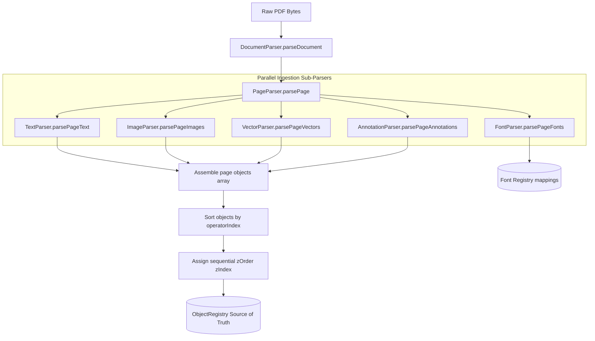
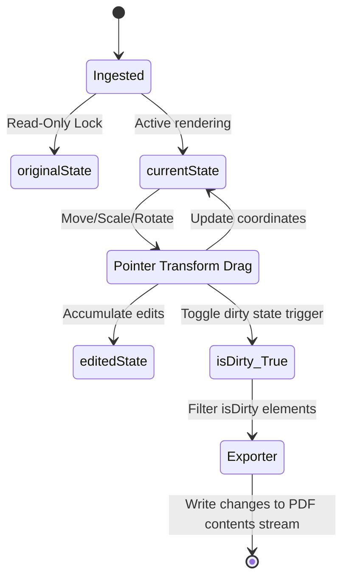
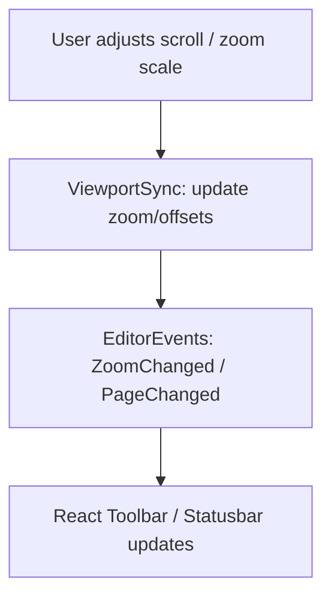
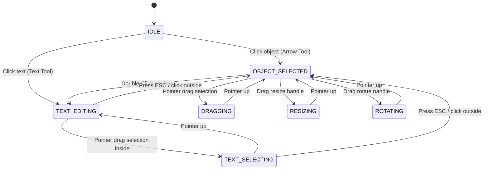

# Architectural Blueprint: ToolWala Native PDF Engine

This document provides a detailed overview of the core architectural pipeline, layers, data flow, rendering passes, and typesetting layouts inside the ToolWala Native PDF Engine SDK.

---

## 🏗 High-Level Architecture Layers

The engine splits tasks across distinct decoupled layers, separating raw PDF ingestion, model storage registries, viewport layout scene graphs, pointer selection editors, and text typesetting:

```
┌─────────────────────────────────────────────────────────────────┐
│                       UI / Canvas Layer                         │
│             (React PDFCanvas / Toolbar Commands Bridge)         │
└────────────────────────────────┬────────────────────────────────┘
                                 │ Event hooks & Redraw requests
┌────────────────────────────────▼────────────────────────────────┐
│                     Caret & Typesetting Layer                   │
│   (CaretEngine / TextSelection / TextLayout / FontMetrics)      │
└────────────────────────────────┬────────────────────────────────┘
                                 │ Layout bounds & Selection boxes
┌────────────────────────────────▼────────────────────────────────┐
│                       Editor Selection Layer                    │
│   (SelectionEngine / HitTest / TransformController / BoundingBox)│
└────────────────────────────────┬────────────────────────────────┘
                                 │ Pointer updates & commits
┌────────────────────────────────▼────────────────────────────────┐
│                       Scene & Render Graph                      │
│     (SceneNode / Camera / Viewport / Culling / RenderGraph)     │
└────────────────────────────────┬────────────────────────────────┘
                                 │ Compiled Render Queue tasks
┌────────────────────────────────▼────────────────────────────────┐
│                      Core Ingestion & Registry                  │
│       (DocumentParser / Sub-Parsers / ObjectRegistry Singleton) │
└─────────────────────────────────────────────────────────────────┘
```

---

## 🔄 Core Ingestion Data Pipeline

This flowchart outlines the ingestion flow from raw PDF byte streams down to the `ObjectRegistry` singleton cache:



---

## 🎨 Scene Graph & Camera Culling Pipeline

This diagram shows how pages and elements ingest into the Scene hierarchy tree:

```mermaid
graph TD
    subgraph Scene Hierarchy Tree
        root[Scene RootNode] --> page1[Page 1 Container Node]
        root --> page2[Page 2 Container Node]
        
        page1 --> pdfL1[Page 1 PDF Layer]
        page1 --> annotL1[Page 1 Annotation Layer]
        page1 --> selectL1[Page 1 Selection Layer]
        
        pdfL1 --> textNode1[Text Object SceneNode]
        pdfL1 --> imgNode1[Image Object SceneNode]
        annotL1 --> annotNode1[Annotation SceneNode]
        
        page2 --> pdfL2[Page 2 PDF Layer]
        pdfL2 --> textNode2[Text Object SceneNode]
    end

    subgraph Render Graph Compiler
        comp[RenderGraph.compileRenderQueue]
        comp --> matUpdate[Propagate local matrices to world matrices]
        comp --> cullCheck[Check CullingManager.shouldCull against Camera Viewport]
        cullCheck -- visible -- qAdd[Add to Render Queue]
        cullCheck -- culled -- qSkip[Skip / Bypass]
        
        qAdd --> sortQueue[Sort Queue: Page -> Layer priority -> local zIndex]
    end
    
    root --> comp
    
    sortQueue --> draw[Draw elements on Canvas within DirtyRegionManager clip bounds]
```

---

## 📝 Text Ingestion & Typesetting Pipeline

This diagram shows how character runs typeset, coordinate positions map to carets, and render selection highlights:

```mermaid
graph TD
    rawText[Raw text block input] --> resolver[FontResolver.resolveFontFamily subset clean]
    resolver --> metrics[FontMetricsRegistry.getMetrics Ascent/Descent]
    metrics --> breaker[LineBreaker.splitLines word wrap]
    
    subgraph Glyph Coordinates Layout
        breaker --> charScan[Iterate characters in each line]
        charScan --> cache[GlyphCache.getGlyphAdvance widths]
        charScan --> kern[Kerning.getSpacingOffset pair adjustments]
        cache --> glyphLayout[Create GlyphLayout relative to line baseline]
        kern --> glyphLayout
    end

    glyphLayout --> layoutCompile[Compile TextLayout runs]
    
    subgraph Caret / Selection Mapper
        layoutCompile --> click[Mouse Click Coordinate]
        click --> caretScan[CaretEngine.clickToCaretIndex find line & character]
        click --> doubleClick[doubleClick: select word boundary]
        click --> tripleClick[tripleClick: select line boundary]
        
        doubleClick --> highlightSelect[TextSelection.getSelectionRects boxes list]
        tripleClick --> highlightSelect
    end
    
    layoutCompile --> renderer[RenderEngine.render text using baseline & GlyphRuns positions]
    highlightSelect --> renderer
```

---

## 💾 Object Registry Transaction & States

Every parsed element in the registry has three state parameters:
1. `originalState`: Read-only, keeps raw values parsed from PDF bytes.
2. `currentState`: Read-write, tracks active layout adjustments on screen.
3. `editedState`: Read-write, records changes that will be serialized back to the PDF.



---

## 💾 Native PDF Writer Pipeline

This flowchart outlines the direct serialization pipeline of our custom native PDF writer, generating document catalog nodes, page hierarchies, compressed font/media resources, and cross-reference offsets table:

```mermaid
graph TD
    doc[TWDocument Tree] --> writer[PDFWriter.writeDocument]
    
    subgraph Object Generation
        writer --> catObj[Catalog & parent Pages indirect objects]
        writer --> infoObj[Info dictionary metadata]
        writer --> fontObjs[Standard core Type1 Font objects]
        writer --> pageObjs[Page objects MediaBoxes & Parents]
      end

    subgraph Content Stream Compilation
        pageObjs --> pageSer[PageSerializer: generateContentsStream]
        pageSer --> textOp[BT/Tf/Tm/Tj Text coordinates operators]
        pageSer --> pathOp[q/RG/w/m/l/c/f Vector operators]
        pageSer --> imgOp[q/cm/Do Image XObject placement operators]
      end

    subgraph Binary Serialization
        textOp --> streamWrite[StreamWriter: format streams & Lengths]
        pathOp --> streamWrite
        imgOp --> streamWrite
        streamWrite --> compress[Compression: dynamic zlib FlateDecode]
      end

    compress --> writeBytes[Serialize all objects and track file offsets]
    writeBytes --> xrefBuild[XRefBuilder: construct cross-reference table]
    xrefBuild --> trailBuild[TrailerBuilder: assemble trailer Root catalog links]
    trailBuild --> mergeBytes[Merge binary buffers to output PDF bytes]
    mergeBytes --> [*]
```

---

## 🔄 Object Mutation Flow

This sequence flowchart details the lifecycle coordinates changes routing through change observers, validators, and stack managers:

```mermaid
graph TD
    userEdit[User performs layout / text edit on screen] --> regUpdate[ObjectRegistry.updateObject]
    
    subgraph Automatic Interception
        regUpdate --> notifyListeners[Invoke registry listeners callbacks]
        notifyListeners --> tracker[ChangeTracker: capture before/after snapshots]
        tracker --> detectType[Classify change: Move, Resize, Rotate, TextReplace...]
      end
      
    detectType --> createMut[Compile Mutation transaction payload]
    createMut --> engine[MutationEngine.applyMutation]
    
    subgraph Operations Coordination
        engine --> validate[MutationValidator: check limits & boundaries]
        validate -- Invalid -- reject[Reject & Discard mutation]
        validate -- Valid -- mergeCheck[MutationMerger: shouldMerge check]
        
        mergeCheck -- Yes -- coalesce[Coalesce states: update last undo stack entry]
        mergeCheck -- No -- pushHistory[Push Mutation onto UndoRedoManager & History timeline]
      end
      
    coalesce --> save[Mutations ready for consolidation & PDFWriter export]
    pushHistory --> save
```

---

## 🔄 UI Synchronization Layer (Phase 5.2)

The UI Synchronization Layer completely decouples view components from active page states, making the native engine the single source of truth and rendering canvases pure output adapters.

### 1. State Synchronization Flow
This diagram details how the registry broadcasts updates to schedule canvas repaints asynchronously:

```mermaid
graph TD
    registry[(ObjectRegistry Source of Truth)] -- updateObject -- syncMgr[CanvasSyncManager]
    syncMgr -- triggerRepaint pageNum -- adapter[RenderAdapter]
    adapter -- renderPage pageNum -- activeRenderer[Active Renderer Wrapper]
    activeRenderer -- repaint -- canvas[HTMLCanvasElement page viewport]
```

### 2. UI Event Flow
This pub-sub observer diagram compiles the coordination of selections, pans, and zoom operations:



### 3. Mutation Dispatch
This flowchart logs the coordinate dragging updates:

```mermaid
graph TD
    userDrag[User drags transform handles] --> controller[InteractionController]
    controller -- x/y updates -- registry[ObjectRegistry.updateObject]
    controller -- before/after states -- dispatcher[MutationDispatcher]
    dispatcher -- applyMutation -- engine[MutationEngine]
```

### 4. Renderer Adapter
This block diagram outlines the active renderer wrapper interface:

```mermaid
graph TD
    reactUI[React View components] --> adapter[RenderAdapter]
    adapter --> rendererInterface[Renderer Interface]
    rendererInterface --> legacyFabric[Legacy Fabric Renderer Adapter]
    rendererInterface --> nativeRenderer[Native Renderer Adapter]

---

## 🔠 Native PDF Text Fidelity Engine (Phase 5.4)

The Native PDF Text Fidelity Engine ensures character-level typesetting matching original PDF document dimensions and positioning coordinates.

### 1. Typesetting & Layout Pipeline
This flow details how text records compile to exact coordinates using typographic subcomponents:

```mermaid
graph TD
    record[Parsed PDF Text Records] --> matcher[FontMatcher: resolve subsets & base families]
    matcher --> fallback[BrowserFontFallback: fallback close system metrics]
    fallback --> resolver[EmbeddedFontResolver: load binary font @font-face]
    resolver --> advEngine[GlyphAdvanceEngine: load explicit design widths]
    advEngine --> matrixCompiler[TextMatrixCompiler: process Tm / Td / T* / Tc / Tw]
    matrixCompiler --> posEngine[CharacterPositionEngine: calculate pixel coordinates per glyph]
    posEngine --> boundsCompiler[TextBoundsCompiler: compile aggregation bounding boxes]
    boundsCompiler --> runCache[FidelityEngine: Layout Cache]
    runCache --> render[RenderEngine: draw individual glyph runs]
```

### 2. Typographic Core Subsystems
* **FontMatcher**: Resolves custom PostScript subsets (`ABCDEF+TimesNewRomanPSMT` -> `Times New Roman`) and standard Core Base14 fonts.
* **EmbeddedFontResolver**: Installs custom OpenType/TrueType binary font face tables dynamically to prevent browser font substitution.
* **BrowserFontFallback**: Compares typographic ascenders, descenders, and average widths to match fallback system fonts.
* **GlyphAdvanceEngine**: Maps proportional PDF glyph spacing widths.
* **TextMatrixCompiler**: Parses transformation matrices mapping skewing, rotations, tracking (`Tc`), word spacing (`Tw`), and subscripts/superscripts rises (`Ts`).
* **CharacterPositionEngine**: Position every character independently, mapping layouts to local pixel positions.
* **FidelityValidator**: Asserts layout matching metrics and measures spacing/baseline alignments drift error.

---

## 🔏 Native Text Editing Session Engine (Phase 5.5)

The Native Text Editing Session Engine manages interaction states, preventing concurrent conflicts between caret typesetting inputs and object dragging coordinates.

### 1. State Machine Transitions
This state machine details how editing modes transition explicitly:



### 2. Core Editing Modules
* **EditingSession**: Encapsulates active session text, caret index, selection start, and selection end metrics.
* **TextInputController**: Dynamically mounts a hidden DOM `<textarea>` to intercept browser keyboard inputs and IME compositions.
* **KeyboardController**: Binds hotkeys for character deletions, cursor navigation, and select-all actions.
* **ClipboardController**: Interfaces with standard browser clipboard APIs for cut, copy, and paste commands.
* **IMEController**: Listens to CompositionStart, CompositionUpdate, and CompositionEnd to support multi-byte inputs.
* **FocusManager**: Routes active browser keyboard focus between the hidden textarea and the active canvas.
* **CursorManager**: Sets canvas pointer styles dynamically (default, text, grab).
* **EditingValidator**: Enforces rules preventing canvas transforms or dragging operations when in TEXT_EDITING state.

---

## 🎨 Native Text Rendering Integration (Phase 5.6)

Phase 5.6 makes the ToolWala Native Engine the sole owner of visible text rendering, bypassing Fabric.js text rendering entirely. Fabric textboxes remain solely as transparent hit-test regions for cursor hovers, selections, and clicks.

### 1. Canvas Rendering Stack Order
Each viewport page canvas is drawn in the following layer sequence:
1. **PDF Background Canvas**: Renders the underlying static original PDF page content.
2. **Whiteout Layer**: Drawn during `before:render` context calls, blanking out original background textboxes that are active or modified.
3. **Native Text Rendering**: Drawn inside `after:render` using `FidelityEngine` compiled character-by-character glyph coordinates.
4. **Native Selection Highlighting**: Displays exact multi-line blue selection blocks matching typographic bounds.
5. **Native Caret Overlay**: Paints the blinking text caret positioned precisely along the local line baseline.
6. **UI Overlays**: Fabric bounds and custom resize controls indicators.

---

## 🔒 Text Layout Stabilization (Phase 5.6.1)

Layout stabilization ensures that text drawing coordinates, selections overlays, and blinking carets sit exactly on identical boundaries on every frame paint, eliminating metrics drift.

### 1. Object-Level Layout Cache Key
The cache key is computed as follows:
`cacheKey = text + "_" + fontFamily + "_" + fontSize + "_" + fontStyle + "_" + fontWeight`

If `cacheKey` remains unchanged, the engine reuses the immutable cached `TextLayout` instance (`obj._cachedLayout`), bypassing all typesetting and kerning spacing calculations completely.
```
